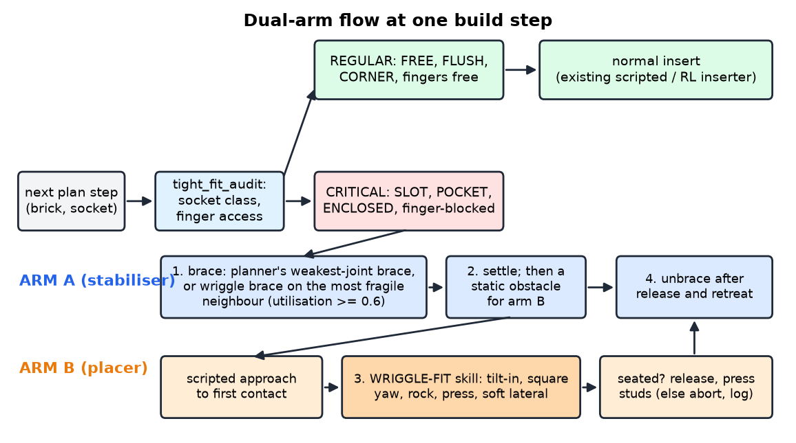
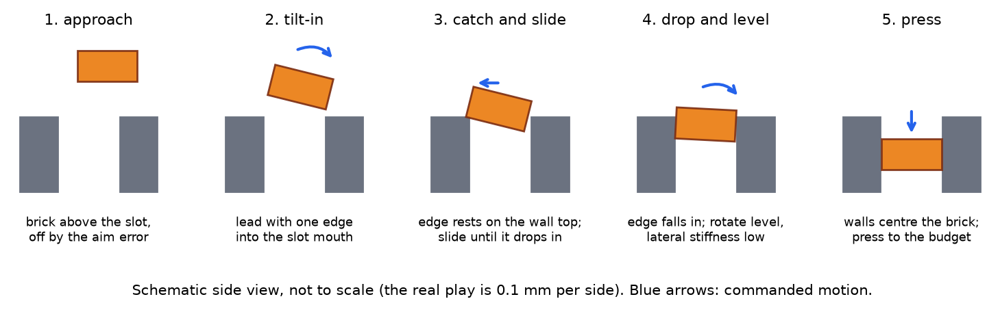
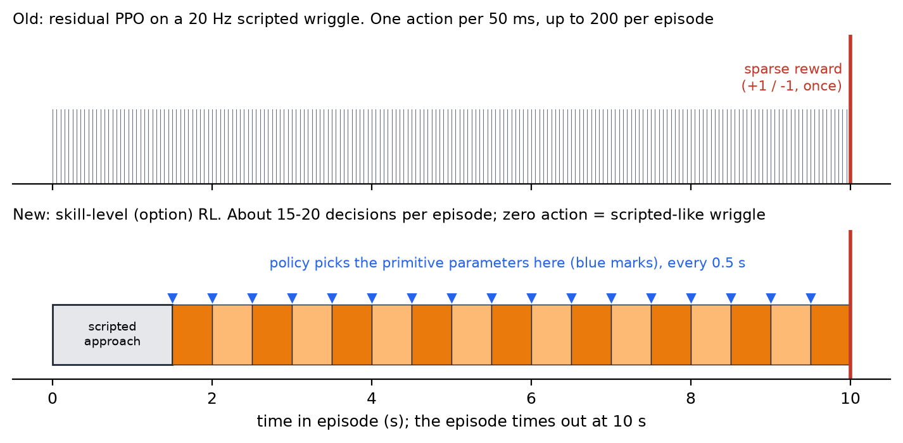
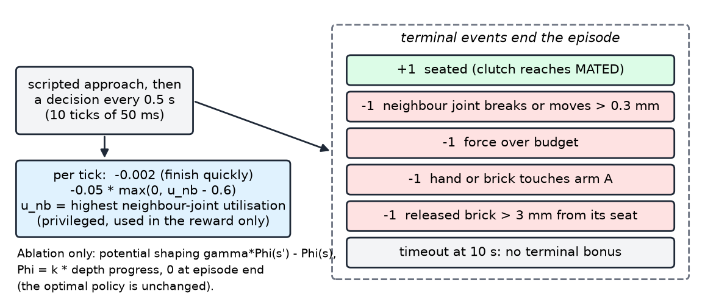

# Wriggle-Fit: a learned skill for fitting bricks into tight sockets in the dual-arm LEGO cell

Design proposal · Tanvir's track · ISDN project, dual-arm LEGO scaffold assembly · draft of 2026-10-23

**Status.** The simulation twin, the scripted baseline and the learning experiments of this session are done. Five PPO runs (four residual, one skill-level) and one evolution-strategy (ES) run did not beat the scripted wriggle; the one real gain came from a physical diagnosis of the grasp (pad shift, section 6.9). Results are in section 9. Every number below comes from a file in the repo, cited in brackets. Figures 2, 6, 7 and 8 are schematics, not data.

## 1. Problem and goal

In the cell, arm A braces the structure and arm B places bricks. Most placements are easy. A few are not: when a brick must drop *between* bricks that are already placed (a gap in the middle of a layer), it fits with **0.1 mm of play per side**. The stud pitch is 8.0 mm and a brick footprint is 8n - 0.2 mm [Sakib/Docs/master_report.md §2.3; Tanvir/WRIGGLE_FIT_RL.md §1]. The cell's aim error is about 0.8 mm (1 sigma) [`insertion_env.BELIEF_SIGMA`, quoted in WRIGGLE_FIT_RL.md §1]. Figure 1 shows both to scale: the aim error is several times larger than the play, so aiming alone cannot work.

**Goal.** Teach arm B a *wriggle-fit* skill: tilt the brick in, catch an edge, slide, level it, press. The skill must work from a coarse aim of 0.5 to 4 mm, with only cheap sensing (no wrist force/torque sensor, no fine vision). Arm A holds the neighbours that a sideways wriggle could pull off. The aim of the project is to avoid needing a very precise position at the critical steps. The wriggling makes up for it.

**Why wriggle and not precision.** A finer pose estimate did not help in the team's earlier RL study (ablation A3: force sensing was enough, vision was not needed) [Sakib/Docs/results_report.md §1, §6]. In a tight socket the failure is not "cannot find the hole". It is breaking the neighbours' stud joints while searching (section 5).

## 2. Fit to the masterplan

### 2.1 Where the design matches and where it deviates

| masterplan element | source | in this design | status |
|---|---|---|---|
| Stabiliser + placer role split | [BUDS]; master_report §1.3 | arm A braces, arm B fits; arm B never commands arm A | match |
| Prioritised planning (stabiliser first, then static obstacle) | master_report §2.5 | brace and settle, then fit (section 3) | match |
| Model-based prior + residual RL, sparse reward | [Marougkas]; §1.4.2, §7.1 | scripted wriggle is the prior; +1/-1 sparse terminal reward | match (the per-step residual did not work, section 7; the skill-level form keeps the prior) |
| Force budget as an input | [FORGE]; §1.3 | budget = (1.55 to 2.0) x studs x 8.9 N, floor 50 N, ends the episode when exceeded (`socket_env.py`) | match |
| Privileged critic that the student can infer | [InformedAAC]; §1.5.1 | critic sees true offset, neighbour joint utilisation, clutch state, physics parameters (WRIGGLE_FIT_RL.md §3.4) | match |
| Domain randomisation | [FORGE], §5.5 | on from the start (section 6.6) | match, ranges differ |
| Curriculum over initial pose error | [IndustReal]; §5.4 | success-band curriculum over socket class x aim error | match, extended |
| Variable compliance action | [VarCompliance]; A8 | lateral stiffness is one of the skill parameters | match (A8 was optional in the plan) |
| Bracing at the weak joint (A6, main experiment) | §1.6, §4.3 | "wriggle brace" trigger picks the neighbour with highest sideways-load utilisation | match, new trigger |
| Wrist F/T history | §5.2 | **cheap wrench from motor torque** (30 % hand-mass model error, noise, drift) | deviates: no F/T sensor; ideal F/T kept as upper-bound ablation |
| Isaac Lab / Newton environment | §2.4 | **MuJoCo twin**, because Newton's cell snaps a brick in place within 2 mm / 1.5 mm / 5 deg (`dual_arm_sim.py` `GATE`) | deviates (section 10) |
| Start error up to 15 mm / 12 deg | §5.4 | **0.5 to 4 mm**, yaw to about 2 deg; this is the final-approach error after a calibrated cell, not coarse transport | deviates, on purpose |
| FORGE success predictor | §1.3, §5.6 | none yet; "seated" is read from the clutch state | deviates (not built) |

### 2.2 What the pipeline does at regular and at critical sockets

The tight-fit audit (`tight_fit_audit.py`) classifies every plan step. Regular sockets (FREE, FLUSH, CORNER with free fingers) use the normal insert. Only critical sockets (SLOT, POCKET, ENCLOSED, and finger-blocked steps) go through brace and wriggle. This keeps the learned skill off the many easy steps, where the existing inserter works.

## 3. System overview

At a critical step the planner's brace is used if it already braces the step (arch step 10). Otherwise the wriggle brace trigger asks whether any same-layer neighbour would exceed utilisation 0.6 under an 8 N sideways load at its top edge. If so, arm A grips that neighbour [WRIGGLE_FIT_RL.md §3.8]. Arm A settles first and then is a static obstacle for arm B. The wriggle then starts from a scripted approach to first contact. After seating, arm B releases and presses the stud tops if the fingers were blocked, then retreats and arm A unbraces.

Why both arms are needed was measured with the scripted wiggle in a 3-neighbour pocket (6 seeds per cell; WRIGGLE_FIT_RL.md §0, `results/slot_probe.md`):

| neighbours | aim 1 mm | 2 mm | 3 mm |
|---|---|---|---|
| not braced | 4/6 (2 breaks) | 3/6 (3 breaks) | 2/6 (3 breaks) |
| braced (stand-in) | **6/6** | 3/6 (3 timeouts) | 2/6 (4 timeouts) |

Bracing removes the breaks. It does not find the hole. That second part is what the learned skill is for.

## 4. Socket taxonomy and audit of the repo assemblies

Classes are set by which faces of the brick touch an already-placed brick in the same layer: FREE (0), FLUSH (1), CORNER (2 adjacent), SLOT (2 opposite), POCKET (3), ENCLOSED (4). SLOT, POCKET and ENCLOSED are *critical*: 0.1 mm play per side on a slot axis [WRIGGLE_FIT_RL.md §1, `results/tight_fit_audit.md`]. A separate difficulty is *finger access*: a placed neighbour under a fingertip blocks the descent.

What the audit shows [`tight_fit_audit.md`; WRIGGLE_FIT_RL.md §1]:

- There are 8 executed SLOT steps: S2 step 6, S4 steps 3, 7, 10, 13, S5 step 4, hollow_box step 7, arch step 10. All are load-bearing except the arch crown, which has nothing above it. S5 step 4 carries 21 bricks.
- If a brick were placed last in its layer, 19 more steps become critical (17 SLOT, 2 POCKET) (`tight_fit_audit.md`, last column). Placing a brick last in its own layer is always buildable.
- All executed SLOTs run along y and leave x free for the fingers: a one-dimensional problem. **No ENCLOSED or POCKET step exists as built.**
- The pyramid has 7 finger-blocked steps (2, 3, 4, 6, 7, 8, 9); steps 2, 3, 4, 7 and 9 have no free pinch axis.

Consequence for the data. The 34 repo contexts that `repo_contexts()` rebuilds (8 executed SLOT, 19 re-ordered, 7 finger-blocked steps) are a good **test set** and a poor **training set**: too few, too uniform, no ENCLOSED. Training uses a procedural socket family (section 6.7).

## 5. Simulation twin and what it can teach

**The v3.1 MuJoCo twin** (Sakib's `InsertionEnv`, extended without edits by `socket_env.SocketInsertionEnv`) has a 1.5 kg hand under task-space impedance control, breakable stud joints (clutch model: 8.9 N insertion and 11.3 N break per stud), and a scripted insertion controller [socket_env.py]. Tanvir's subclass adds any socket context, finger pads, a releasable grasp, the cheap wrench, the brace stand-in and a keep-out volume for arm A. About 100 to 150 policy steps per second per core [WRIGGLE_FIT_RL.md §3.6].

**The slot probe** (`slot_probe.py`, scripted base, 2x4 brick, 6 seeds per cell) checks that the twin reproduces the tight-socket problem:

- An open socket is always solved up to 2 mm (6/6) and fails from 3 mm (1/6, then 0/6 at 4 mm).
- The pocket loses 2, 3 and 3 of 6 episodes to joint breaks at 1, 2 and 3 mm. The neighbour that breaks is always the 1x2 side neighbour.
- Braced, the breaks disappear (0), but at 2 mm and above the episodes time out instead.

**What the twin cannot teach.** The v4 Newton cell welds a brick in place when it is within 2 mm laterally, 1.5 mm vertically and 5 deg, so a 0.1 mm slot is not tight there. It also has no stud interference model and no force loop for arm B (`dual_arm_sim.py`, `plan_v4.md`; WRIGGLE_FIT_RL.md §2.3, §8). Training therefore stays in MuJoCo. Further limits of the twin: placed bricks are rigid until their joint breaks, brick walls do not collide with walls (only top plates and studs do), and LEGO batch variation is only partly randomised (WRIGGLE_FIT_RL.md §7).

Earlier RL in the same twin (Sakib) seated 66 to 99 % at stage 0 (no neighbours) but only 19 to 24 % at stage 3 (3-neighbour pocket), and it relied on a wrist F/T history [Sakib/Docs/results_report.md §6; WRIGGLE_FIT_RL.md §2.2]. No run had really trained at stage 3.

## 6. Methodology

### 6.1 The wriggle primitive

The classic way to fit a tight peg (Whitney's jamming and wedging analysis [Whitney 1982]) has five parts: tilt the part so one edge leads, catch that edge on a wall and use it as a reference, slide until the edge drops, rotate level while compliant, and press. Soft lateral stiffness lets the 0.1 mm walls centre the brick instead of the sensor. Yaw must also be squared: a 2x4 jams in its slot beyond about 0.36 deg of yaw, and the scripted rock only tilts (WRIGGLE_FIT_RL.md §6.2).

### 6.2 Why skill-level learning (the supervisor's decision for the retrain)

The old policy was a residual PPO on a 20 Hz scripted wriggle. It never beat the scripted wriggle (section 7). The learning signal was weak: a sparse reward after up to 200 steps, and about 10 finished episodes per update (WRIGGLE_FIT_RL.md §6.7). The retrain therefore uses a **skill-level (option) formulation** (WRIGGLE_FIT_RL.md §6.9; `skill_env.py`):

1. A scripted approach brings the brick to first contact. This is not a decision.
2. From there, every **0.5 s** (K = 10 ticks, one period of the 2 Hz rock) the policy outputs theta in [-1, 1]^10, which parameterises the wriggle primitive (section 6.4). An episode has about 2 to 17 decisions instead of 200 actions.
3. **Zero action = the scripted wriggle**, checked by a test (same reason, step count and peak force on the same seed). Training starts at the scripted level.
4. The same primitive is searched by **two learners**: PPO (section 6.5) and a small evolution strategy (section 6.5). In the PPO smoke run an update held 206 to 413 finished episodes, against about 10 before (WRIGGLE_FIT_RL.md §6.9).

Why this should be easier to learn was a hypothesis, not a result: fewer decisions share the same sparse reward, and the policy cannot command arbitrary per-tick motion. Section 9 reports that it did not produce a policy better than the scripted one.

### 6.3 Sensing (cheap only)

| signal | real-arm source | twin model |
|---|---|---|
| joint state, hand pose | encoders | hand pose and velocity |
| contact wrench estimate | motor torque or current (e.g. Franka `tau_ext`) | true wrench + 30 % hand-mass model error x acceleration, white noise 3 N / 0.15 N m per 2 ms tick before a 30 ms low-pass, tare offset within 0.5 N with drift (0.02 N per step, cap 2 N) |
| impedance tracking error | controller state | always present, so "no wrench" still feels contact |
| depth progress | forward kinematics against the believed seat | the brick drops when it lines up: the strongest cheap cue |
| socket description | the plan | 32 numbers: faces, class, slot axes, free pinch axes, brick type, layer, mating studs, budget |
| coarse target pose | plan + calibrated cell | aim error 0.5 to 4 mm by curriculum level; yaw error +-(0.5 + 0.375 L) deg |
| brace state | plan + arm A's joint torques | active flag, braced face, strength, felt reaction (9 numbers) |

Source: WRIGGLE_FIT_RL.md §3.2; `socket_env.CHEAP`. Not given to the policy: wrist F/T, fine vision, the true offset to the socket. An ideal F/T sensor is kept only as an upper-bound ablation. At each decision the PPO actor sees a 97-number summary of the last 0.5 s window (WRIGGLE_FIT_RL.md §6.9): depth progress and its change, mean/min/max wrench estimate, tracking error, velocities, hand pose against the believed pose, controller phase, accumulated centre offset, elapsed time, the previous theta, plus the 32 socket numbers and 9 brace numbers. The critic adds the 28 privileged numbers of the env. The ES policy uses only 8 of these features (section 6.5).

### 6.4 Action space: ten primitive parameters

Each channel is mapped piecewise-linearly so that 0 gives the scripted value (WRIGGLE_FIT_RL.md §6.9, `skill_env.py`):

| theta channel | what it does in the wriggle | range (0 = scripted value) |
|---|---|---|
| centre nudge x, y | moves the centre of the search spiral | +-0.6 mm per decision, kept within 4 mm of the believed target |
| static tilt roll, pitch | holds a tilt so one edge leads (search phase) | +-3 deg; commanded tilt capped at 5.5 deg |
| yaw offset | squares the brick to the slot | +-1.5 deg about the believed yaw |
| rock amplitude | size of the 2 Hz rocking | 0 to 3 deg (scripted 1.5 deg) |
| rock yaw mix | adds a yaw component to the rock | 0 at theta = 0 (the scripted rock only tilts) |
| press force | search and seating press | search 2 to 24 N (scripted 8 N); seating 0.4 to 1.2 x scripted, at most 0.9 of the budget |
| lateral stiffness | soft lets the walls centre the brick | scale 0.15 to 1; positive theta equals 0 (no stiffer-than-scripted half) |
| spiral radius | size of the search spiral | 0 to 3 mm (scripted 2 mm) |

The scripted release rule for finger-blocked sockets and the post-release press stay scripted; they are not decisions.

### 6.5 Reward, termination and the two learners

The reward is sparse: +1 seated, -1 for each failure event. Two small running terms stay: -0.002 per tick, and a gentle charge on the highest neighbour-joint utilisation above 0.6, which charges for loading a neighbour before it breaks. The skill-level PPO adds depth-potential shaping at the macro level, 0.5 x (0.97 Phi(s') - Phi(s)), which leaves the optimal policy unchanged (WRIGGLE_FIT_RL.md §6.9).

**PPO** (`train_skill.py`): Sakib's `ActorCritic` (2 x 256) with a zero-initialised mean, initial exploration std 0.4, a privileged asymmetric critic, 7 workers x 3 envs, 1,050 macro steps per update, the success-band curriculum with a 10 % uniform share over all buckets.

**ES** (`es_skill.py`, WRIGGLE_FIT_RL.md §6.11), added because PPO barely moved: the policy is theta = clip(b[socket class] + W z, -1, 1) with a per-class bias b (6 x 10) and a 10 x 8 matrix W on eight cheap features (depth progress and its change, wrench z, lateral wrench, tracking error, elapsed time, released flag, brace flag): **140 parameters**, all zero at the start (theta = 0 exactly). Search: mirrored OpenAI-ES, **8 pairs per generation**, sigma 0.2 on b and 0.1 on W, centred-rank fitness, Adam with learning rate 0.05. All candidates of a generation share one **24-episode common-random-number batch** (one episode per class x aim level 0 to 3, a random train-split context, brace alternating none and ideal), so differences between candidates are paired. The current mean is scored on every batch and theta = 0 on every third, giving a paired improvement estimate. The **pad shift** (section 6.9) is on. Selection is on a 120-episode validation split, with ties going to theta = 0.

The critic is privileged and asymmetric (section 2.1) for PPO only.

### 6.6 Domain randomisation, from the start

| parameter | range in the twin | source |
|---|---|---|
| brick-brick friction | U(0.3, 0.9) | `socket_env.py` reset |
| stud break force | 11.3 N x U(0.8, 1.2) | same |
| gate lateral tolerance | 1.2 mm x U(0.75, 1.25) | same |
| impedance gain multiplier | U(0.8, 1.25) | same |
| force budget | U(1.55, 2.0) x studs x 8.9 N, floor 50 N | same |
| aim error | by level: 0.5, 1, 2, 3, 4 mm (level L draws from U(previous, L)) | `ERR_LEVELS` |
| yaw error | +-(0.5 + 0.375 L) deg | same |
| start hand offset | +-0.5 mm laterally | same |
| cheap-wrench noise, tare, drift | see section 6.3 | `CHEAP` |
| brace condition | none 40 %, ideal 40 % (neighbour joints x10 + arm A keep-out), weak 20 % (x2.5 + keep-out) | WRIGGLE_FIT_RL.md §3.8 |
| layer, support strength | layer 0/1/2 with p = 0.5/0.35/0.15; half the draws leave a neighbour on 1 to 2 studs | `socket_family.py` |

### 6.7 Curriculum and data split

**Curriculum: success band over socket class x aim error.** The axes are class (FREE, FLUSH, CORNER, SLOT, POCKET, ENCLOSED) x aim-error level (5 levels): 30 buckets. A running success rate is kept per bucket; most samples come from buckets between 20 % and 80 % success, plus 10 % uniform. A bucket opens only if its neighbour holds at least 50 % and the overall rate stays above 40 % (`--unlock-gate`). This replaces the fixed 4-stage ladder, which never reached the pocket (WRIGGLE_FIT_RL.md §3.6, §6.5). With about 20 decisions per episode, an episode is cheaper to sample than a 200-step one.

**Training data: a procedural socket family** (`socket_family.py`). It draws the target (8 brick types, weighted to 2-wide), the layer, one neighbour per required face with random type and overlap, support layers by `blueprint.tile`, and often one fragile neighbour. Splits use disjoint seed offsets (train 0, validation 100,000, test 200,000), deterministic in (seed, class). It guarantees the ENCLOSED case that the repo lacks.

**Test data: held-out repo contexts.** 34 contexts from the repo's real assemblies, rebuilt with real neighbours and supports, never trained on. Evaluated with no brace, the planner's brace, and the wriggle brace.

### 6.8 Brace conditions and the wriggle-brace trigger

Each training episode draws a brace condition (section 6.6) so the policy learns to fit with and without help, and not to touch arm A. The trigger (`wriggle_brace.py`, F_LAT = 8 N, threshold 0.6) flags the 1x2 side neighbour in the slot probe (u = 0.85) and not the 2x2 neighbours (u = 0.21). On repo contexts it braces 1x1 and 1x2 neighbours of the pyramid (u up to 1.7) and none of the SLOTs, whose neighbours sit on 4 to 8 studs (u <= 0.28). The planner's own brace is not edited. The fitting arm logs neighbour utilisation traces and arm A's reaction, as training labels for Sakib's brace selector [WRIGGLE_FIT_RL.md §3.8].

### 6.9 Grasp geometry: the pad shift

While diagnosing why FLUSH sockets seated 0/12 for the PPO checkpoint and poorly for the scripted base, a per-tick trace showed that the descent stops 5 to 7.5 mm above the seat with a finger pad resting on the flush neighbour's studs. The pads are 17.5 mm wide and centred on the brick; a 1-wide brick is 7.8 mm and a 2-wide one 15.8 mm, so they overhang by 4.85 mm and 0.85 mm per side, over the neighbour. The scripted controller then spirals and presses with the pad on the neighbour (timeouts, 70 N presses, neighbour joint breaks). It is a grasp-point effect, not a controller bug (`results/flush_trace.md`; WRIGGLE_FIT_RL.md §6.10).

**Fix:** when exactly one face perpendicular to the pinch axis touches a neighbour, the pads sit off-centre, away from that neighbour, with the pad edge 0.2 mm inside the brick face (`pad_shift=True`, a grasp choice made from the plan). Scripted, no brace, one seed:

| sockets | pad centred | pad shifted |
|---|---|---|
| FLUSH family (6 train + 6 validation contexts x levels 0, 2) | 9/24 | **16/24** |
| `pyramid_b_006_exec` | 0/6 | **6/6** |
| `pyramid_b_008_exec` | 0/6 | **5/6** |

CORNER and SLOT (24 episodes each) do not change (10/24 and 7/24), because the shift does not apply there.

## 7. What was tried and what it taught

Four things are on record. Training success is the success rate over the last 200 training episodes (`train.jsonl`).

### 7.1 Scripted baseline

The scripted wriggle seats about half at <= 0.5 mm in SLOT, POCKET and ENCLOSED, and falls to 0 to 18 % at 3 to 4 mm. On the 34 held-out repo contexts with no brace it seats 33/68, 22/68 and 9/68 at <= 0.5, 1 to 2 and 3 to 4 mm; on family test sockets 32/60, 23/60 and 3/60 (WRIGGLE_FIT_RL.md §6.7). Failures in the first baseline run were joint breaks (87 of 204 repo episodes) and timeouts (36). Two physical causes: yaw jam, and joint breaks of neighbours and deeper supports. The wriggle brace halves the breaks but the scripted controller then hits arm A (arm contact 59 of 390 episodes, `scripted_cheap_v2.md`). The pyramid's finger-blocked steps are hardest (5/54 seated, WRIGGLE_FIT_RL.md §6.2).

### 7.2 Behaviour cloning (end-to-end) failed

BC on 123 seated scripted episodes (10,179 samples) reached loss 0.005 but seated 0/72 family-test episodes closed-loop (`results/eval/bc_only_family.md`; `runs/main_attempt1`). Small per-step errors in the integrated target accumulate, and the teacher's phase is not visible in the observation.

### 7.3 Residual run `main`: collapse

1.5 M samples, 2 h 51 min on 7 workers. The policy started at the scripted level (0.85 success) and fell to 0.05 (Figure 10). The held-out repo evaluation seated 2/204 against the scripted 64/204 (`results/eval/main_repo_none.md`; WRIGGLE_FIT_RL.md §6.4). The curriculum opened 10 of 30 buckets in the first 55 k samples and never reached SLOT, POCKET or ENCLOSED (Figure 12).

### 7.4 Safeguards, a false termination, shaping

Safeguards (`--safe`): residual capped at 0.3 of the range, release left to the scripted base, L2 penalty on the residual, critic warm-up, curriculum gate, checkpoints with validation selection (checkpoint 0 is the scripted base). A trace of 9 "lost brick" episodes showed none was lost: the check measured the *hand*, which springs about 1 mm sideways after release, not the *brick*. The check was fixed (`LOST_ERR` on the brick, 3 mm); the scripted baseline moved little (WRIGGLE_FIT_RL.md §6.6, §6.7).

Results: the safeguards fix the collapse (training success holds at about 0.4 at 300 k against 0.12 for `main` at the same point), and `safe_short2` reached the first SLOT bucket. Still **no trained checkpoint beat the scripted base on validation**: best 31/72 (`safe_short2`) and 32/72 (`safe_shaped`) against 37/72. `safe_shaped` is the only run whose validation score rises with training (27, 29, 32), but the difference is within noise. **Lesson:** the safeguards remove the failure modes, but the signal is too weak: sparse +-1 reward, about 10 episodes per update, success near 40 %. That led to the skill-level design of section 6.2.

## 8. Evaluation plan and success criteria

**Main result.** On the held-out repo contexts at 2 mm aim error with cheap sensing only: **at least 85 % seated and zero neighbour breaks**. The scripted base is the floor (22/68 at 1 to 2 mm, section 7.1); the open version of each socket is the ceiling.

Report mean and 95 % CI over 5 training seeds x 100 evaluation episodes per context, with peak force, peak neighbour utilisation and time to seat (WRIGGLE_FIT_RL.md §5). Validation selection uses the family validation split and can never return a policy worse than the scripted base.

| ablation | question |
|---|---|
| cheap wrench vs ideal wrist F/T vs no force | how much does the costly sensor buy? (thesis: little; cf. A3) |
| with vs without the stiffness parameter | does compliance do the centring? |
| with vs without the tilt and yaw parameters | is tilt-in or squaring what solves SLOT and POCKET? |
| with vs without the neighbour-utilisation charge | does it remove the joint breaks? |
| success-band curriculum vs fixed stages | does training reach POCKET and ENCLOSED? |
| skill-level vs per-step residual | does the coarser decision rate fix the weak signal? |
| {no brace, planner brace, wriggle brace} x {scripted, learned} | the dual-arm result (masterplan A6 at tight steps) |
| trained with vs without brace conditions | does an unbraced-only policy collide with arm A? |
| domain randomisation on vs off, held-out physics | robustness (masterplan A7) |

## 9. Results of this session's retrain

Measured numbers only. Sources: `results/runs/skill_main/train.jsonl`, `results/eval/diag_ckpt45k.md`, `results/flush_trace.md`, `results/runs/es_main/{train.jsonl,select.json}`, `results/eval/es_main.md`, `es_main_zero.md`, `scripted_cheap_v2.md`, and WRIGGLE_FIT_RL.md §6.9 to §6.11.

### 9.1 Skill-level PPO (`skill_main`): no improvement

The run was stopped by the supervisor after update 46 (48,300 macro steps, 12 buckets unlocked). Training success over the last 200 episodes went 0.80 (update 1), 0.47 (6), 0.38 (16), 0.42 (26), 0.38 (36), 0.45 (46). The exploration std went from 0.400 to 0.393 and the largest mean theta stayed at 0.09 or below: the policy hardly moved. On the 72-episode validation set the last checkpoint (`ckpt_00045150`) seated **28/72**, against **37/72** for checkpoint 0 (theta = 0) and the scripted controller (`diag_ckpt45k.md`). FLUSH was 0/12 for the policy, which led to the diagnosis of section 6.9.

### 9.2 Pad shift: the one real gain

See the table in section 6.9: FLUSH family 9/24 to 16/24, `pyramid_b_006` 0/6 to 6/6, `pyramid_b_008` 0/6 to 5/6, seven episodes changed and all to seated.

### 9.3 Evolution strategy (`es_main`): no improvement

13 generations were run on 7 workers (the first generation took 479 s for 432 episodes, about 1.1 s per episode). The paired fitness difference of the current mean against theta = 0 on the same batch, where theta = 0 was scored (`train.jsonl`):

| generation | 1 | 4 | 7 | 10 | 13 |
|---|---|---|---|---|---|
| paired difference (mean - theta 0) | 0.000 | +0.049 | -0.018 | -0.12 | -0.27 |

Validation, seated of 120 episodes, same episodes and seeds for all (`select.json`):

| candidate | theta = 0 | gen 11 | gen 12 | gen 13 | gen 14 mean | average of the last four |
|---|---|---|---|---|---|---|
| seated / 120 | **67** | 50 | 53 | 52 | 50 | 50 |
| joint breaks | 25 | 27 | 29 | 27 | 29 | 28 |

theta = 0 was selected, so the held-out ES evaluation (`es_main.md`) is identical to the pad-shifted scripted baseline (`es_main_zero.md`).

### 9.4 Held-out evaluation: centred scripted against pad-shifted scripted

Seated / 68 (repo contexts) or / 60 (family test), by aim-error level; two seeds per cell, cheap sensing. "Old" is `scripted_cheap_v2.md` (centred pads); "pad shift" is `es_main_zero.md` (= `es_main.md`). Counted from the `.jsonl` files. "Ideal brace" is the wriggle brace.

| contexts, brace | pads | aim <= 0.5 mm | aim 1 to 2 mm | aim 3 to 4 mm |
|---|---|---|---|---|
| repo, none | old | 33/68 | 22/68 | 9/68 |
| repo, none | pad shift | **38/68** | **26/68** | 8/68 |
| repo, ideal brace | old | 31/68 | 22/68 | 9/68 |
| repo, ideal brace | pad shift | **36/68** | **26/68** | 8/68 |
| family, none | old | 32/60 | 23/60 | 3/60 |
| family, none | pad shift | 30/60 | 25/60 | 2/60 |

Joint breaks over the repo, brace-none rows (204 episodes): 87 with centred pads, 82 with the pad shift.

By socket class (all brace conditions, 780 episodes, `es_main_zero.md`): FLUSH 40/84 (was 18/84 in `scripted_cheap_v2.md`), SLOT 136/360 (was 140/360), CORNER 21/120 (was 19/120), POCKET 20/96 (was 23/96), ENCLOSED 12/60, FREE 26/60.

### 9.5 Verdict

- **No learned policy beat the scripted wriggle in this session**: five PPO runs (four residual: `main`, `safe_short`, `safe_short2`, `safe_shaped`; one skill-level: `skill_main`) and one ES run. In every validation the scripted base was selected or was higher.
- **The one real gain came from a physical diagnosis** (grasp geometry), not from learning: at 1 to 2 mm the held-out repo rate went from 22/68 to 26/68 (32 % to 38 %).
- **The 85 % target at 2 mm is far off**: 26/68 = 38 %.
- **Joint breaks remain the dominant failure**: 82 of the 204 repo, brace-none episodes.
- Caveat: the learning budgets were small (48,300 macro steps; 13 ES generations of 24 episodes), so these are negative results at this budget, not proof that learning cannot help.

## 10. Risks, sim-to-real, Newton path and next steps

**Risks.**

- *The skill-level policy may still not beat the scripted base.* The three residual runs agreed that nothing beat checkpoint 0 within 300 k samples. Checkpoint selection guards the result, and a negative result is stated plainly.
- *Cheap wrench fidelity.* A real motor-torque estimate is worse than any noise model; keep the "no force" ablation (WRIGGLE_FIT_RL.md §7).
- *The brace stand-in is optimistic.* 10x joint strength is not an arm. The real brace is compliant (about 1.6 N/mm at the hand) and has collided with arm B in the v4 cell (1019 N arm-to-arm contact on the arch) [Sakib/Docs/plan_v4_rl_brace.md facts 3, 4]. The scripted base hits arm A in 59 of 390 braced episodes. Learning to use the brace without touching arm A is part of the task.
- *Rigid twin neighbours, wall contact model, small probe sample (n = 6).* Phase 0 should re-measure the probe at n >= 100.
- *Sim to real.* LEGO interference varies by batch and age. The masterplan's caution applies: failure during insertion has a small sim-to-real gap, failure during search a much larger one [CompliantFingers; master_report §1.4.4].
- *Statistical power.* With 72 validation episodes one standard error is about 4 episodes. Use more validation seeds before drawing conclusions.

**Newton porting path.** Eight changes are needed before wriggle-fit can run in the v4 cell (WRIGGLE_FIT_RL.md §8): a continuous gate tightened to about 0.3 mm instead of the one-shot 2 mm check; a stud-interference model (hold to n x 8.9 N, break at 11.3 N per stud) as a Warp kernel; task-space impedance for arm B (which also yields the wrench estimate); zero collider inset between same-layer neighbours (the 0.1 mm inset makes the slot about 0.3 mm per side); a press-speed cap; a `BatchedWriggleEnv` with the 9-D action and the section 6.3 observation; the real arm-A brace and arm-arm contact termination; and a validation gate (the slot probe protocol must match the twin within 10 points) before any training there. The observation, action and reward are defined without reference to the simulator, so a twin-trained policy can be loaded there unchanged.

**Next steps (supervisor's recommendation).**

1. **Trace the SLOT joint-break episodes** the same way FLUSH was traced, before any more learning. SLOT is 360 of the 780 held-out episodes.
2. **Learn with much larger batches**: ES or PPO with at least 200 episodes per generation, or on the HPC cluster at 5 to 20 M steps (WRIGGLE_FIT_RL.md §3.6).
3. **Question the 3 to 4 mm levels.** The calibrated aim error is 0.8 mm (1 sigma), so 4 mm is a 5 sigma case; the curriculum may spend effort on cases that do not occur.
4. **Newton port only after step 1.** Then re-measure the slot probe at n >= 100, then run the full repo evaluation with the three brace conditions and the section 8 ablations.

## References

Project files (all under the repo root): `Tanvir/WRIGGLE_FIT_RL.md`; `Tanvir/results/tight_fit_audit.md`, `slot_probe.md`, `eval/*.md`, `runs/*/train.jsonl`, `select.json`, `buckets.json`; `Tanvir/socket_env.py`, `socket_family.py`, `wriggle_brace.py`; `Sakib/Docs/master_report.md`, `results_report.md`, `plan_v4_rl_brace.md`, `plan_v4_rl_place.md`.

- [BUDS] Grannen, J., et al. (2023). Stabilize to Act: Learning to Coordinate for Bimanual Manipulation. CoRL. 10.48550/arXiv.2309.01087
- [FORGE] Noseworthy, M., et al. (2025). FORGE: Force-Guided Exploration for Robust Contact-Rich Manipulation under Uncertainty. IEEE RA-L. 10.1109/LRA.2025.3551637
- [Marougkas] Marougkas, I., et al. (2025). Integrating Model-Based Control and RL for Sim2Real Transfer of Tight Insertion Policies. ICRA. 10.1109/ICRA55743.2025.11128860
- [InformedAAC] Ebi, et al. (2025). Informed Asymmetric Actor-Critic. 10.48550/arXiv.2509.26000
- [IndustReal] Tang, B., et al. (2023). IndustReal: Transferring Contact-Rich Assembly Tasks from Simulation to Reality. RSS. 10.48550/arXiv.2305.17110
- [VarCompliance] Beltran-Hernandez, C., et al. (2020). Variable Compliance Control for Robotic Peg-in-Hole Assembly. Applied Sciences 10(19). 10.3390/app10196923
- [CompliantFingers] Hartisch, et al. (2025). Toward Simulation-Based Optimization of Compliant Fingers for High-Speed Connector Assembly. IEEE RA-L. 10.1109/LRA.2026.3655310
- [Whitney 1982] Whitney, D. E. (1982). Quasi-static assembly of compliantly supported rigid parts. ASME Journal of Dynamic Systems, Measurement, and Control 104(1), 65-77.
